  

Estudante de Sistemas de Informação na PUC-Campinas e estagiário de desenvolvimento na AgRoss.

Trabalho com Oracle e PL/SQL em sistemas internos de gestão de estoque e armazém — desde modelagem e consultas até as interfaces web em PHP e JavaScript que consomem esses dados. Boa parte do que faço envolve entender regra de negócio antes de escrever código: por que o processo é daquele jeito, o que quebra quando muda.

Nos projetos pessoais sigo a mesma ideia — construo o que eu (ou alguém perto de mim) precisa de verdade.

  

## Projetos

  
  

## Contato

[LinkedIn](https://www.linkedin.com/in/otaviofelix) · [otavio.felix433@gmail.com](mailto:otavio.felix433@gmail.com)
