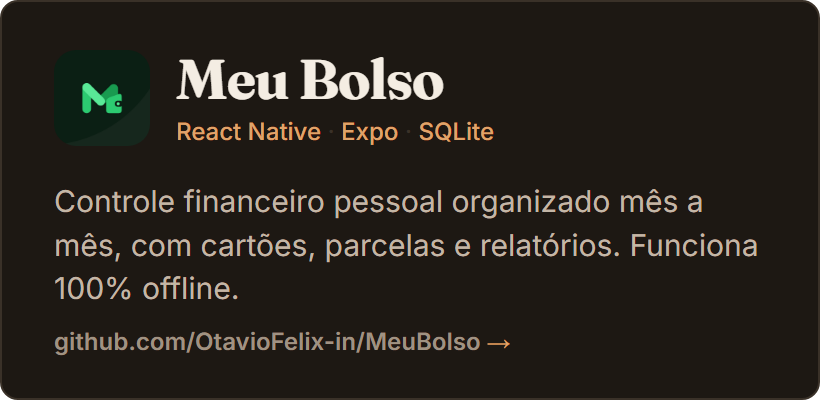
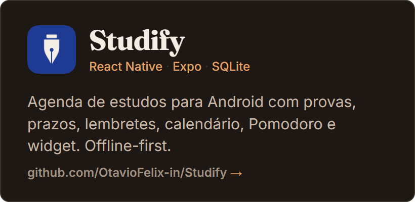

Estudante de Sistemas de Informação na PUC-Campinas e estagiário de desenvolvimento na AgRoss, onde trabalho com Oracle e PL/SQL em sistemas internos de gestão de estoque e armazém: da modelagem e das consultas às interfaces web em PHP e JavaScript que consomem esses dados.

Antes de escrever código, procuro entender a regra de negócio: por que o processo é daquele jeito e o que quebra quando ele muda. Nos projetos pessoais sigo a mesma ideia e construo aplicativos para problemas reais.

### Stack

| Área | Tecnologias |
|---|---|
| Banco de dados | Oracle, PL/SQL, SQL, SQLite |
| Back-end | PHP |
| Front-end | JavaScript, HTML, CSS |
| Mobile | React Native, Expo |
| Nuvem | Supabase |

### Projetos

  
  

### Contato

[Site](https://otaviofelix-in.github.io/site/) · [LinkedIn](https://www.linkedin.com/in/otaviofelix) · [otavio.felix433@gmail.com](mailto:otavio.felix433@gmail.com)
